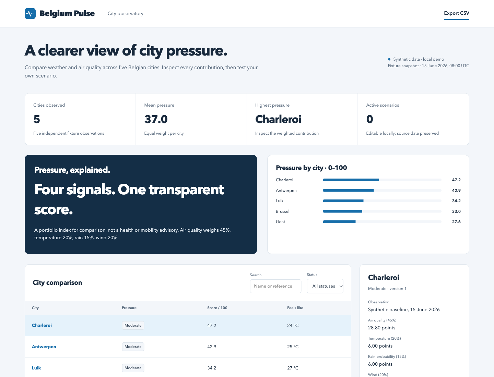

# Belgium Pulse

An interactive Belgian city observatory with a transparent weighted pressure index and persistent what-if scenarios.

**[View the public project page](https://phlppgdfry.github.io/belgium-pulse/)** · The full interactive application runs locally.

[](https://github.com/phlppgdfry/belgium-pulse/actions/workflows/demo.yml)



## Run it in one command

Requires Python 3.11+ with SQLite support. No pip install, account, API key or Node runtime is needed to run the application.

```bash
git clone https://github.com/phlppgdfry/belgium-pulse.git
cd belgium-pulse
python3 -m demo.server
```

Open **http://127.0.0.1:8111**. The first start seeds `var/demo.sqlite3`; later starts preserve changes. The server binds to loopback only.

Use a new database path for a fresh workspace, without overwriting existing work:

```bash
python3 -m demo.server --port 8211 --db var/fresh-demo.sqlite3
```

## Try the complete workflow

1. Select Charleroi and inspect the four weighted score contributions.
2. Set the apparent temperature to 35 °C and apply the scenario. Watch the score, ranking and mean change.
3. Reload to verify persistence, then restore the original inputs. Export the current observations as CSV.

Search and status filtering, record inspection, CSV export, input errors, an activity log, responsive layouts, individual SVG branding, favicons and Apple touch icons are included.

## Why this project exists

City-level weather and air observations are hard to compare when each signal has a different unit and scale.

The implementation completes one demonstrable product slice, with explicit business rules and verifiable state changes. This is a **local portfolio demonstration with synthetic data**, not an operating service or evidence of client outcomes.

## Business rules

- Score = 45% capped European AQI + 20% temperature stress + 15% rain probability + 20% wind stress.
- Temperature stress = min(100, abs(apparent °C − 18) × 5); wind stress = min(100, wind km/h × 2). Each input contribution is capped before weighting.
- The score is rounded to one decimal. Low < 30; moderate 30–<60; high ≥60. These are demonstration thresholds, not validated public-health categories.
- The five city observations are fictional baseline fixtures; applying a scenario changes only the local demo database.

## Verify and reproduce

```bash
make check                 # domain, HTTP, transaction and concurrency tests + syntax checks
make report                # deterministic baseline JSON and CSV; does not modify the database
```

Node 24+ is used only for JavaScript syntax checks and browser verification. The browser suite has a pinned development dependency:

```bash
npm ci
npx playwright install chromium
npm run test:e2e
```

The seven Chromium tests start an isolated Python server and temporary database, then clean it up. They cover branding/assets, filtering, 390/768/1440 px widths the complete domain workflow, and the public project page. GitHub Actions also runs Python tests on 3.11 and 3.14. See [validation evidence](docs/validation.md).

Baseline evidence is committed in [reports/baseline/snapshot.json](reports/baseline/snapshot.json) and [records.csv](reports/baseline/records.csv). These are generated from the fixtures, not a screenshot of arbitrary runtime state.

## Engineering decisions

**Reuse the existing scorer.** The demo imports src/belgium_pulse/scoring.py instead of creating a second formula. Contribution checks allow 0.05 rounding tolerance.

**Keep live ingestion separate.** A reviewer can run the entire demo offline. The optional Open-Meteo ingestion writes CSV, never silently replaces synthetic browser fixtures.

**Expose the components.** A composite score is useful only when a reviewer can inspect how air, temperature, rain and wind contribute.

The browser uses semantic HTML, native JavaScript modules and CSS. The Python application separates input contracts, domain rules, transactional persistence and HTTP transport. Records use optimistic version checks; each mutation and its audit entry commit together. Rejected actions leave both unchanged.

## Scope and evidence

No live traffic, iRail, energy feed, historical lakehouse, production Power BI report or Fabric deployment is delivered by this demo. The existing Power BI assets are a starter kit. The city index has no scientific validation.

The June concept is retained in [original-concept.md](docs/original-concept.md), explicitly labelled as unverified history. Current functionality is defined by the source, tests and this README. The demo has no authentication or tenant boundaries; use fictional data and keep it local.

## Explore the repository

| Resource | Purpose |
| --- | --- |
| [demo/domain.py](demo/domain.py) | Fixtures, calculations and use cases |
| [demo/store.py](demo/store.py) | SQLite transactions, optimistic versions and audit log |
| [demo/web/feature.js](demo/web/feature.js) | Domain-specific forms and details |
| [tests](tests) | Domain, persistence, HTTP and browser verification |
| [Architecture](docs/architecture.md) | Boundaries, tradeoffs and data flow |
| [API contract](docs/api.md) | Routes, payloads and errors |
| [Case study](docs/case-study.md) | Problem, acceptance criteria and delivery scope |
| [Runbook](docs/runbook.md) | Start, inspect, export and recover |
| [Mobile preview](docs/mobile.png) | 390 px workspace |

Built by [Philippe Godfroy](https://github.com/phlppgdfry).

For the preserved optional ingestion and Power BI assets, see [live-pipeline.md](docs/live-pipeline.md).
